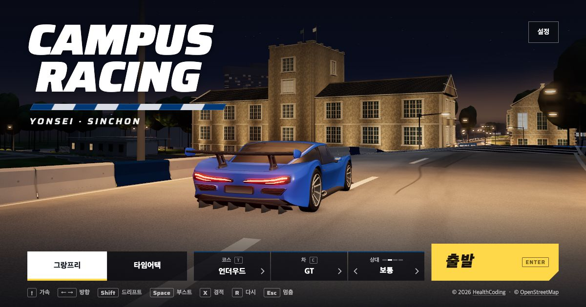

# Campus Racing

밤의 신촌 캠퍼스를 달리는 웹 레이싱 게임이에요.

플레이: https://campus-racing.vercel.app

## 조작

PC

| 키 | 동작 |
| --- | --- |
| ↑ | 가속 |
| ↓ | 브레이크 · 후진 |
| ← → | 방향 |
| Shift | 드리프트 |
| Space | 부스트 |
| X | 경적 |
| R | 다시 시작 |
| Esc | 멈춤 · 계속 |

휴대폰: 가속은 저절로 돼요. 오른쪽 아래 ◀ ▶ 로 방향을 틀고, 왼쪽 아래 단추로 드리프트 · 부스트 · 브레이크를 써요. 설정에서 조향을 왼손으로 바꿀 수 있어요.

WebGL 2 를 지원하는 브라우저에서 돌아가요.

## 코스 · 모드

- 코스: 언더우드 · 청송대, 캠퍼스 롤러코스터
- 그랑프리 — 상대 차들과 겨루는 경주
- 타임어택 — 혼자 달리며 기록 줄이기

## 순위표

기록을 처음 올릴 때 정한 닉네임 · 단과대(고르지 않아도 돼요)와 차 · 기록이 순위표에 공개돼요. 그 뒤로는 새 최고 기록이 저절로 올라가요. 기록을 검증하려고 주행 입력도 함께 보내요. 기록을 올린 브라우저의 설정에서 '내 기록 지우기'로 지울 수 있어요.

## 만든 사람 · 저작권

© 2026 HealthCoding. 학교와 관계없는 개인 프로젝트예요.

## 이용 조건

- 출처를 밝히면 비상업적으로 자유롭게 가져다 쓰고, 고치고, 다시 올릴 수 있어요. 자기 학교 버전을 만들어도 돼요.
- 코드는 [PolyForm Noncommercial 1.0.0](https://polyformproject.org/licenses/noncommercial/1.0.0), HealthCoding 이 만든 3D · 그림 · 소리 · 음악은 [CC BY-NC 4.0](https://creativecommons.org/licenses/by-nc/4.0/) 이에요.
- 출처는 'Campus Racing © 2026 HealthCoding' 과 원본 주소(https://campus-racing.vercel.app 또는 https://github.com/HealthCoding/campus-racing)로 적어요. 공식판처럼 보이게 하면 안 돼요.
- 플레이 화면 · 영상 · 방송은 수익이 나도 자유예요. 그 밖의 상업적 이용(판매 · 광고 · 유료 서비스 등)은 허락이 필요해요.
- 캠퍼스와 코스의 지도 좌표 부분은 OpenStreetMap 자료로, ODbL 1.0 을 따라요(© OpenStreetMap contributors). `bts/` 는 Beat the School 의 이용 조건을, 제3자 부품은 각자의 라이선스를 따라요.
- 카카오톡 공유 단추의 키와 아이콘은 이 저장소에 없어요(키가 비어 있으면 단추가 안 보여요). 쓰려면 자기 카카오 개발자 앱의 JavaScript 키를 `src/shared/kakao-key.js` 에 넣고, 아이콘은 카카오디벨로퍼스에서 받아 `assets/kakao/` 에 두세요.
- 자세한 내용은 [LICENSE](LICENSE) · [NOTICE.md](NOTICE.md) 에 있어요.

## English

Campus Racing is a web racing game set on the Sinchon campus at night. © 2026 HealthCoding — a personal project unrelated to the school. You are welcome to play it, share links to it and post videos or streams of your play, including monetised ones. You may use, change and republish it for non-commercial purposes, including making a version for your own school, as long as you credit "Campus Racing © 2026 HealthCoding" with the original address and do not present it as official. The code is under the PolyForm Noncommercial License 1.0.0 and HealthCoding's own 3D models, images, sounds and music are under CC BY-NC 4.0; other commercial use needs permission. Third-party components follow their own licenses, the bts/ material follows the Beat the School terms, and the map-derived coordinate data is © OpenStreetMap contributors under ODbL 1.0. Leaderboard entries show your nickname, optional college, car and time, and driving inputs are sent to verify each run. See [LICENSE](LICENSE) and [NOTICE.md](NOTICE.md). The KakaoTalk share key and icon are not included in this repository (with an empty key the button is hidden); if you host a copy and want the button, put your own Kakao JavaScript key in `src/shared/kakao-key.js` and download the icon from Kakao Developers into `assets/kakao/`.

문의 / Contact: healthcoding15@gmail.com
